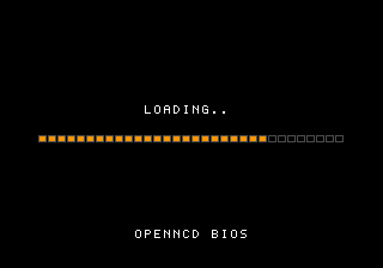

# OpenNCD BIOS

An original, clean-room replacement system ROM ("BIOS") for **emulated** NEOGEO CD hardware.

[日本語版 README はこちら](README_ja.md)



Most "compatible" NEOGEO CD BIOS images in circulation are dumps of the original ROM with a few bytes patched. OpenNCD BIOS is not one of them: every instruction and every table in it was written or generated for this project. It contains no SNK code or data. See [docs/CLEANROOM.md](docs/CLEANROOM.md) for how that was done and how to check it yourself.

It is meant for emulators only. It has never been run on a real console.

## Status

Version 2.1. The same 512 KB image works in two kinds of emulator and picks the right mode by itself:

| Emulator | Mode | Result |
|---|---|---|
| MAME 0.264 (`neocdz`) | BIOS drives the CD hardware itself | 5 of 5 test games boot and play |
| NeoCD libretro core (RetroArch) | BIOS drives the CD hardware itself | 5 of 5 test games boot; 2 played in depth |
| NeoRaine 1.4.3 | Emulator loads files, BIOS provides services | 5 of 5 test games boot and play |
| Raine (versions after NeoRaine 1.4.3) | Emulator loads files | **Untested.** Landmarks for its BIOS scan are present |
| FinalBurn Neo | BIOS drives the CD hardware itself | **Untested.** FBNeo only accepts BIOS files with known CRCs |
| Real hardware | | **Not supported, never tried** |

The five test games are Viewpoint, The King of Fighters '94, Flying Power Disc (Windjammers), Quiz King of Fighters and Twinkle Star Sprites. Nothing else has been tried, and none of them was played to the end. Details, including what "play" means for each cell and how CD audio was checked, are in [docs/TESTING.md](docs/TESTING.md).

## Getting it

Download `neocd.bin` from the [Releases](../../releases) page, or build it yourself (below). Setup for each emulator is in [docs/EMULATORS.md](docs/EMULATORS.md); in short:

- **MAME**: put it at `roms/neocdz/neocd.bin`. MAME warns about the checksum and runs anyway. MAME also wants `000-lo.lo`, which this project does not provide.
- **RetroArch (NeoCD core)**: put it in `system/neocd/` and select it in the core options.
- **NeoRaine**: select it as the NeoCD BIOS.

You know it is running when you see the loading screen shown above.

This repository contains no games, no disc images and no SNK ROMs, and it will not help you obtain them.

## Building

You need Python 3 and the m68k build of GNU binutils.

```sh
sudo apt install binutils-m68k-linux-gnu    # Debian / Ubuntu
python3 build.py                            # or: make
```

This writes two files to `out/`:

- `neocd.bin`: byte-swapped word order, the format emulators expect
- `neocd_be.bin`: the same image in plain big-endian order, for reading in a disassembler

The build is deterministic. Pushing a tag such as `v2.0` makes GitHub Actions build the image and attach it to a release.

| File | Contents |
|---|---|
| `src/bios.s` | Vectors, jump table, system calls, memory card, text output, loading screen |
| `src/cdsys.s` | Drive commands, sector reading, ISO 9660, IPL.TXT, file transfer, CD audio |
| `tables.py` | Generates the direction, distance, sine and random tables games read from ROM |
| `font.py` | The hand-drawn 5x7 font and progress bar tiles |
| `build.py` | Assembles, places tables and font, checks fixed addresses, writes both images |
| `tools/similarity_check.py` | Compares a build against a reference ROM you supply |
| `tests/` | Self-test disc: a 40-file load list and memory card round trips |

## What is implemented

- Boot from disc: ISO 9660 root directory, `IPL.TXT`, loading of PRG, FIX, SPR, Z80, PCM and PAT files
- `BIOSF_LOADFILE`, `BIOSF_LOADFILEX`, `BIOSF_UPLOAD`, `BIOSF_CDDACMD`, `BIOSF_VIDEOEN`, `BIOSF_RESETGAME`, `BIOSF_CDPLAYER`, and the sound command call at `$C00576`
- `SYSTEM_INT1`, `SYSTEM_INT2`, `SYSTEM_RETURN`, `SYSTEM_IO`, `CREDIT_CHECK`, `CREDIT_DOWN`
- `CARD` and `CARD_ERROR` on the internal backup RAM, `FIX_CLEAR`, `LSP_1st`, `MESS_OUT`, `CONTROLLER_SETUP`
- CD audio with looping and play-once, by BIOS call or by the command pair games leave in Z80 RAM
- The ROM data tables at `$C02000`, `$C03000`, `$C04000` and `$C04200`
- Its own loading screen and exception screen

## Known limitations

- No boot logo and no CD player screen. "Exit" in a game restarts the disc.
- Home console mode only: no MVS mode, credits or calendar.
- CD audio stops while files are loading.
- `MESS_OUT` commands 8 and 9 (8x16 text) are implemented from an ambiguous description.
- The random table is original, so random sequences differ from the original ROM.
- In MAME, a game that calls a load in user mode keeps receiving vertical blank interrupts during the load, because MAME does not emulate the interrupt mask register. The test games are not affected.
- The track list a real BIOS keeps in RAM (`$10F570`) is not filled in, so a game that reads the disc's table of contents from there sees zeroes.
- CD audio commands 3 and 6 are documented differently by different sources. Here 2 and 6 pause and 3 and 7 resume.

## Contributing

Bug reports with the emulator, its version and the game are welcome. Before sending code, read [CONTRIBUTING.md](CONTRIBUTING.md): contributions derived from disassembling an original BIOS cannot be accepted.

## Legal

OpenNCD BIOS is released under the [zlib License](LICENSE). You may bundle `neocd.bin` with an emulator without adding any notice. If you distribute a modified version, mark it clearly as modified and do not present it as the original.

Versions up to and including 2.0 were released under the MIT License, which still applies to those versions.

NEOGEO and NEOGEO CD are trademarks of SNK CORPORATION. This project is not affiliated with or endorsed by SNK. The names are used only to say what the software is compatible with.

This is not legal advice. If you plan to redistribute this ROM as part of a product, ask a lawyer.

## References

- [NeoGeo Development Wiki](https://wiki.neogeodev.org/)
- [MAME](https://github.com/mamedev/mame) (`neogeocd.cpp`, `megacdcd.cpp`)
- [FinalBurn Neo](https://github.com/finalburnneo/FBNeo) (`neo_run.cpp`)
- [NeoCD libretro core](https://github.com/libretro/neocd_libretro)
- [Raine](https://github.com/zelurker/raine)
