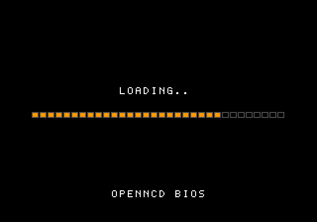

# OpenNCD BIOS

**エミュレータ用**に、ゼロから書き起こした NEOGEO CD 互換システム ROM（BIOS）です。

[English README](README.md)



出回っている NEOGEO CD の「互換 BIOS」の多くは、本体からダンプした ROM に数バイトのパッチを当てただけのものです。OpenNCD BIOS はそうではなく、命令も数表もすべてこのプロジェクトのために書いた、または生成したものです。SNK のコードやデータは含みません。どう作ったか、どうやって自分で確かめられるかは [docs/CLEANROOM.md](docs/CLEANROOM.md) にまとめています。

対象はエミュレータだけです。実機で動かしたことはありません。

## 対応状況

バージョン 2.3。同じ 512KB のイメージが 2 種類のエミュレータで動き、どちらのモードで動くかは自動で判定します。

| エミュレータ | モード | 結果 |
|---|---|---|
| MAME 0.264（`neocdz`） | BIOS が CD 回路を直接操作 | テスト 5 本すべて起動・プレイ可 |
| NeoCD libretro コア（RetroArch） | BIOS が CD 回路を直接操作 | 5 本すべて起動、うち 2 本を本編まで確認 |
| NeoRaine 1.4.3 | エミュレータが読み込みを代行 | テスト 5 本すべて起動・プレイ可 |
| Raine 0.98 | エミュレータが読み込みを代行 | 5 本中 4 本の起動を確認。デモとスタートボタンまで（検証記録を参照） |
| FinalBurn Neo | BIOS が CD 回路を直接操作 | **未検証**。FBNeo は CRC が既知の BIOS しか読み込みません |
| 実機 | | **非対応・未確認** |

テストした 5 本は、ビューポイント、ザ・キング・オブ・ファイターズ'94、フライングパワーディスク、クイズ キング・オブ・ファイターズ、ティンクルスタースプライツです。それ以外は試しておらず、どれも最終面までは遊んでいません。各欄の「プレイ可」が何を指すか、CD-DA をどう確かめたかは [docs/TESTING.md](docs/TESTING.md) を見てください。

## 入手と使い方

[Releases](../../releases) から `neocd.bin` をダウンロードするか、下の手順で自分でビルドします。エミュレータごとの設定は [docs/EMULATORS.md](docs/EMULATORS.md) にあります。要点だけ書くと:

- **MAME**: `roms/neocdz/neocd.bin` として置きます。チェックサムの警告が出ますがそのまま動きます。MAME は `000-lo.lo` も要求しますが、このプロジェクトでは提供しません。
- **RetroArch（NeoCD コア）**: `system/neocd/` に置き、コアオプションで選びます。
- **NeoRaine / Raine**: NeoCD の BIOS として指定します。

上の画像のロード画面が出れば、この BIOS で動いています。

このリポジトリにはゲーム、ディスクイメージ、SNK の ROM は含まれません。入手方法の案内もしません。

## ビルド

Python 3 と、GNU binutils の m68k 版が必要です。

```sh
sudo apt install binutils-m68k-linux-gnu    # Debian / Ubuntu
python3 build.py                            # または make
```

`out/` に 2 つのファイルができます。

- `neocd.bin`: バイトスワップ形式。エミュレータが読む形式です
- `neocd_be.bin`: 同じ内容のビッグエンディアン版。逆アセンブラで読むときに使います

ビルド結果は毎回同じになります。`v2.0` のようなタグを push すると、GitHub Actions がビルドして Releases に添付します。

| ファイル | 内容 |
|---|---|
| `src/bios.s` | ベクタ、ジャンプテーブル、システムコール、メモリーカード、文字出力、ロード画面 |
| `src/cdsys.s` | ドライブ命令、セクタ読み込み、ISO 9660、IPL.TXT、ファイル転送、CD-DA |
| `tables.py` | ゲームが ROM から直接読む方向・距離・正弦・乱数の表を生成 |
| `font.py` | 手描きの 5x7 フォントと進捗バーのタイル |
| `build.py` | アセンブル、表とフォントの配置、固定番地の検査、2 形式の出力 |
| `tools/similarity_check.py` | 手元の参照 ROM とビルド結果を比較 |
| `tests/` | 自己テスト用ディスク（40 本のロードリストとメモリーカードの読み書き） |

## 実装済みの機能

- ディスクからの起動: ISO 9660 のルートディレクトリ、`IPL.TXT`、PRG / FIX / SPR / Z80 / PCM / PAT の読み込み
- `BIOSF_LOADFILE`、`BIOSF_LOADFILEX`、`BIOSF_UPLOAD`、`BIOSF_CDDACMD`、`BIOSF_VIDEOEN`、`BIOSF_RESETGAME`、`BIOSF_CDPLAYER`、`$C00576` のサウンドコマンド送出
- `SYSTEM_INT1`、`SYSTEM_INT2`、`SYSTEM_RETURN`、`SYSTEM_IO`、`CREDIT_CHECK`、`CREDIT_DOWN`
- 内蔵バックアップ RAM に対する `CARD` と `CARD_ERROR`、`FIX_CLEAR`、`LSP_1st`、`MESS_OUT`、`CONTROLLER_SETUP`
- CD-DA のループ再生と 1 回再生（BIOS コール方式と、Z80 RAM に命令を置く方式の両方）
- `$C02000`、`$C03000`、`$C04000`、`$C04200` の数表
- 独自のロード画面と例外画面

## 既知の制限

- 起動ロゴと CD プレーヤー画面はありません。ゲームの「EXIT」はディスクの再起動になります。
- 家庭用モード固定です。MVS モード、クレジット、カレンダーはありません。
- ファイルのロード中は CD-DA が止まります。
- `MESS_OUT` のコマンド 8 と 9（8x16 文字）は、仕様の記述が曖昧な部分を推定で実装しています。
- 乱数表が独自なので、乱数の出方は純正 ROM と一致しません。
- 純正 BIOS が RAM（`$10F570`）に持つトラック一覧は作っていません。ディスクの目次をそこから読むゲームにはゼロが見えます。
- CD-DA コマンドの 3 と 6 は資料によって説明が食い違っています。この BIOS では 2 と 6 が一時停止、3 と 7 が再開です。

## コントリビュート

エミュレータ名、そのバージョン、ゲーム名を添えた不具合報告を歓迎します。コードを送る前に [CONTRIBUTING.md](CONTRIBUTING.md) を読んでください。純正 BIOS の逆アセンブルに由来する変更は受け付けられません。

## 権利表記

OpenNCD BIOS は [zlib ライセンス](LICENSE) で公開しています。`neocd.bin` をエミュレータに同梱するとき、表示を添える必要はありません。改変版を配布する場合は、改変版であることを明示し、オリジナルと偽らないでください。

バージョン 2.0 までは MIT ライセンスで公開しており、それらの版には引き続き MIT ライセンスが適用されます。

NEOGEO および NEOGEO CD は株式会社 SNK の商標です。このプロジェクトは SNK と関係がなく、承認も受けていません。名称は互換対象を示すためだけに使っています。

これは法的助言ではありません。この ROM を製品に組み込んで再配布する場合は、専門家に確認してください。

## 参考にした公開情報

- [NeoGeo Development Wiki](https://wiki.neogeodev.org/)
- [MAME](https://github.com/mamedev/mame)（`neogeocd.cpp`、`megacdcd.cpp`）
- [FinalBurn Neo](https://github.com/finalburnneo/FBNeo)（`neo_run.cpp`）
- [NeoCD libretro コア](https://github.com/libretro/neocd_libretro)
- [Raine](https://github.com/zelurker/raine)
